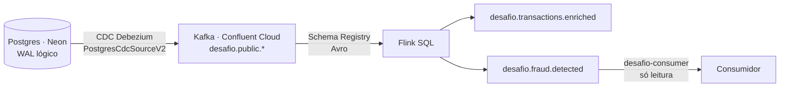
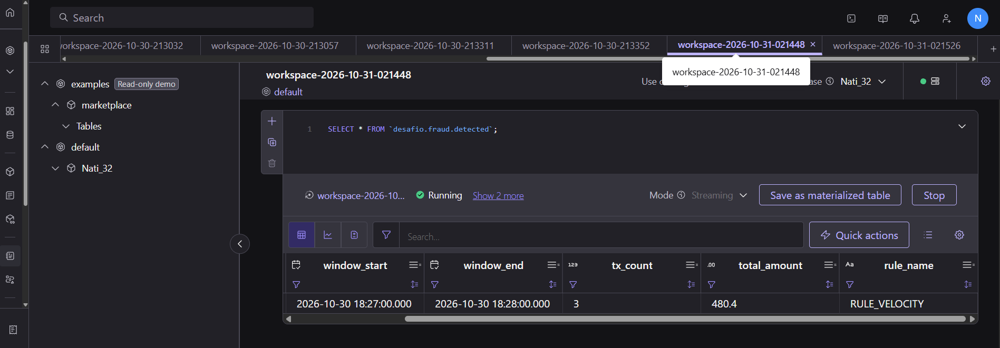
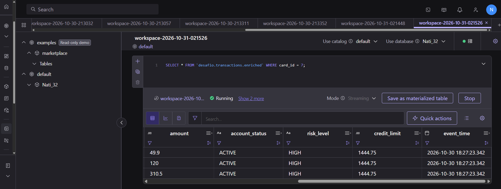
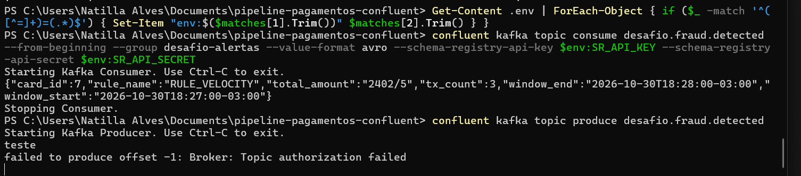
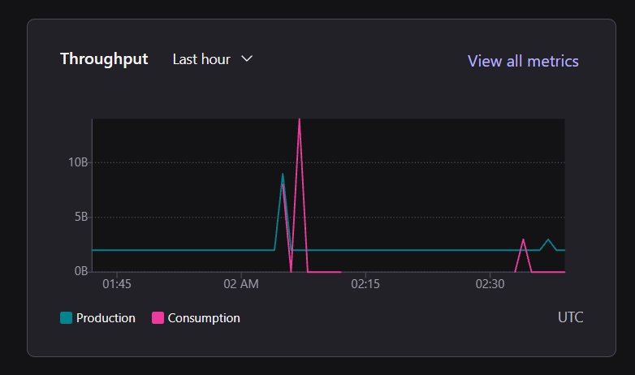
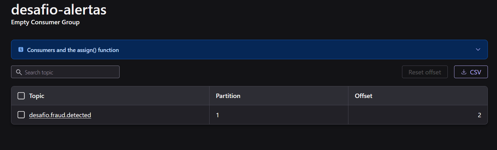
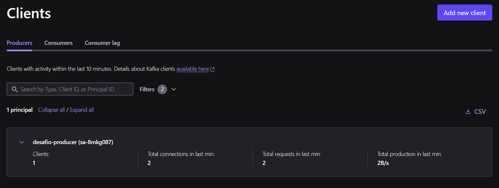
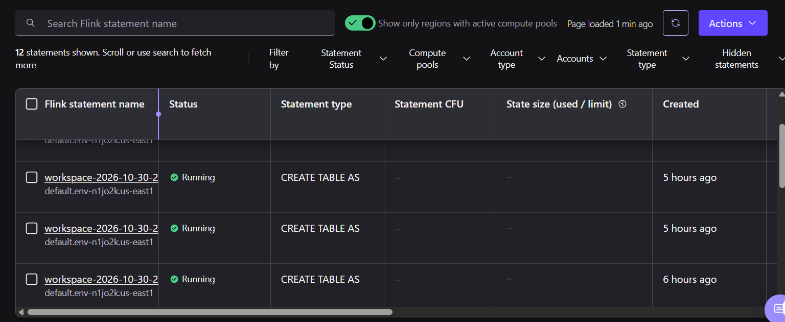

# Pipeline de pagamentos em tempo real — Confluent Cloud

Pipeline de ponta a ponta que leva transações de um Postgres para o streaming por CDC, enriquece cada transação com os dados da conta e marca as suspeitas de fraude com Flink SQL. Desafio final do bootcamp **IBM Confluent — Dados em tempo real para agentes de IA (DIO)**.

**Resultado:** 3 transações do mesmo cartão em menos de 60 segundos geraram o alerta `RULE_VELOCITY`, lido por um consumidor que só tem permissão de leitura. Custo do pipeline: cerca de US$ 7 em conector e Flink, coberto por créditos de avaliação.

## Arquitetura



| Peça | Onde | Detalhe |
| --- | --- | --- |
| Banco | Neon, AWS us-east-1 | Postgres com replicação lógica, 5 tabelas |
| Kafka | Confluent Cloud, GCP us-east1 | cluster `Nati_32` (`lkc-j5rw7mm`), environment `default` |
| Schema Registry | Stream Governance Essentials | `lsrc-rr6zwm9`, compatibilidade BACKWARD |
| CDC | Connector gerenciado | `PostgresCdcSourceV2` (`lcc-0xyyrr2`) |
| Processamento | Flink SQL | compute pool `lfcp-22y86go`, máx. 10 CFU |

## Estrutura do repositório

```text
db/seed.sql                      tabelas, dados sintéticos (seed 42), publicação e permissões do cdc_user
db/eventos-teste.sql             INSERT, UPDATE e DELETE de teste e o disparo da regra de fraude
schemas/                         Avro v1, v2 (compatível) e v3 (quebra o contrato)
connectors/cdc.json.template     configuração do conector, sem segredos
scripts/gerar-cdc-json.ps1       gera o cdc.json a partir do .env
sql/                             queries Flink, na ordem de execução
evidencias/                      saídas de comando e prints de cada camada
```

## Como subir do zero

Pré-requisitos: conta no Confluent Cloud e no Neon, [Confluent CLI](https://docs.confluent.io/confluent-cli/current/install.html), Git e PowerShell. Os comandos abaixo são para Windows (PowerShell).

1. `Copy-Item .env.example .env` e preencha os valores à medida que forem criados. O `.env` está no `.gitignore`.
2. Siga as camadas na ordem. Cada uma tem o comando que gerou a evidência.

## Camada 1 — Fundação

**O que faz:** environment, cluster e duas identidades de aplicação com menor privilégio.

```powershell
confluent login --save
confluent environment use <env-id>
confluent kafka cluster use <lkc-id>
confluent iam service-account create desafio-producer --description "Escreve nos topicos do desafio (conector CDC)"
confluent iam service-account create desafio-consumer --description "Le os alertas de fraude"

# producer: cria e escreve só em tópicos desafio* e no heartbeat do Debezium
confluent kafka acl create --allow --service-account <sa-producer> --operations create,write,describe --topic desafio --prefix
confluent kafka acl create --allow --service-account <sa-producer> --operations create,write,describe --topic __debezium-heartbeat --prefix
confluent kafka acl create --allow --service-account <sa-producer> --operations describe,idempotent-write --cluster-scope

# consumer: só lê tópicos e grupos desafio*
confluent kafka acl create --allow --service-account <sa-consumer> --operations read,describe --topic desafio --prefix
confluent kafka acl create --allow --service-account <sa-consumer> --operations read --consumer-group desafio --prefix
```

**Por quê:** aplicações não usam a conta pessoal. Uma service account por papel permite auditar quem fez o quê e limitar o estrago de uma chave vazada. As ACLs por prefixo `desafio` deixam cada identidade fazer só o que o seu papel exige.

**Evidência:** [01-service-accounts.txt](evidencias/01-service-accounts.txt) · [02-acls-producer.txt](evidencias/02-acls-producer.txt) · [03-acls-consumer.txt](evidencias/03-acls-consumer.txt)

## Camada 2 — Contrato

**O que faz:** schema Avro `com.bootcamp.payments.Transaction` no Schema Registry, com valor em `decimal(15,2)`, e teste de evolução no modo BACKWARD.

```powershell
confluent iam rbac role-binding create --principal User:<sa-producer> --role DeveloperWrite --environment <env-id> --schema-registry-cluster <lsrc-id> --resource "Subject:desafio" --prefix
confluent iam rbac role-binding create --principal User:<sa-consumer> --role DeveloperRead  --environment <env-id> --schema-registry-cluster <lsrc-id> --resource "Subject:desafio" --prefix

confluent schema-registry schema create --subject desafio.payments.transaction-value --schema schemas\transaction-v1.avsc --type avro
confluent schema-registry schema compatibility validate schemas\transaction-v2-ok.avsc     --type avro --subject desafio.payments.transaction-value --version 1
confluent schema-registry schema compatibility validate schemas\transaction-v3-quebra.avsc --type avro --subject desafio.payments.transaction-value --version latest
```

| Teste | Resultado | Por quê |
| --- | --- | --- |
| v2 contra v1 | `Compatible: true` | O campo novo `channel` tem default `"POS"`: um consumidor novo consegue ler mensagens antigas. |
| v3 contra v2 | `Compatible: false` | O campo `installments` é obrigatório e sem default: um consumidor novo não conseguiria ler mensagens antigas, então o registro é bloqueado. |

**Por quê:** valor monetário em `decimal` evita erro de arredondamento de `float`. O contrato é validado antes do deploy; uma quebra apareceria como consumidor travado com lag subindo, não como erro no produtor.

**Evidência:** [04-compat-v2-ok.txt](evidencias/04-compat-v2-ok.txt) · [05-compat-v3-quebra.txt](evidencias/05-compat-v3-quebra.txt)

## Camada 3 — Ingestão (CDC)

**O que faz:** o conector `PostgresCdcSourceV2` lê o WAL do Postgres pelo slot `desafio_slot` e publica cada mudança como evento em `desafio.public.<tabela>`.

Preparação do banco (Neon): replicação lógica ativada, usuário `cdc_user` criado pela Console e [db/seed.sql](db/seed.sql) executado (50 clientes, 50 contas, 100 cartões, 20 lojas, 500 transações, `REPLICA IDENTITY FULL` e publicação `desafio_pub`).

```powershell
.\scripts\gerar-cdc-json.ps1
confluent connect cluster create --config-file connectors\cdc.json
confluent connect cluster list      # status RUNNING
confluent kafka topic list          # 5 tópicos desafio.public.* + heartbeat
```

**Por que CDC e não batch:** ler o log de transações captura INSERT, UPDATE e DELETE na ordem exata dos commits, sem carga extra nas tabelas. Polling por `updated_at` não vê DELETE e perde estados intermediários; batch noturno entregaria a fraude com um dia de atraso.

**Escolhas do conector:** `after.state.only=false` mantém o envelope com `before`, `after` e `op`; `REPLICA IDENTITY FULL` faz o UPDATE e o DELETE trazerem a linha anterior completa; `heartbeat.interval.ms=60000` evita que o slot segure WAL quando o banco fica parado; o conector usa a service account do producer, não uma chave pessoal.

**Evidência:** o tópico `desafio.public.transactions` fechou com 503 mensagens: 500 do snapshot (`op = r`), o INSERT, o DELETE e o tombstone.

| Evento | Tópico · offset | O que mostra |
| --- | --- | --- |
| INSERT (`op = c`) | transactions · 500 | `before: null`, `after` com a transação 501 |
| UPDATE (`op = u`) | accounts · 50 | conta 3: `status` ACTIVE no `before`, BLOCKED no `after` |
| DELETE (`op = d`) | transactions · 501 | `before` com a transação 500, `after: null` |
| Tombstone | transactions · 502 | chave 500 com valor vazio |

[07-envelopes-cdc.json](evidencias/07-envelopes-cdc.json) · [07a-conector-running.txt](evidencias/07a-conector-running.txt) · [07b-topicos.txt](evidencias/07b-topicos.txt)

Contagem após o seed, no SQL Editor do Neon:

| tabela | linhas |
| --- | --- |
| customers | 50 |
| accounts | 50 |
| cards | 100 |
| merchants | 20 |
| transactions | 500 |
| wal_level | logical |

## Camada 4 — Processamento (Flink SQL)

**O que faz:** três queries contínuas, na ordem dos arquivos em [sql/](sql/):

1. [00-formato-cdc.sql](sql/00-formato-cdc.sql): por padrão o Flink lê o tópico do Debezium como changelog (`avro-debezium-registry`, `retract`). Janelas de tempo exigem fluxo só de inserções, então as tabelas passam a ser lidas como envelope cru (`append`, `avro-registry`) e o filtro por `op` decide o que conta.
2. [01-watermarks.sql](sql/01-watermarks.sql): watermark 1 s atrás do evento mais recente, para as janelas fecharem rápido com pouco tráfego.
3. [02-accounts-versioned.sql](sql/02-accounts-versioned.sql): versão de cada conta ao longo do tempo, com chave primária, base do join temporal.
4. [03-enrichment.sql](sql/03-enrichment.sql): **join temporal**. Cada transação recebe status, risco e limite que a conta tinha **no momento da transação**, não os de agora.
5. [04-fraud-rule.sql](sql/04-fraud-rule.sql): **RULE_VELOCITY**. Janela `TUMBLE` de 60 s por cartão, alerta com 3 ou mais transações novas (`op = 'c'`).

**Por que essa janela:** tumbling é a janela mais barata em estado, e cada evento cai em uma janela só. O filtro `op = 'c'` ignora as 500 linhas do snapshot, que chegam todas no mesmo segundo e gerariam alertas falsos. Limitação: com janela fixa, 2 transações no fim de uma janela e 1 no começo da seguinte passam sem alerta. Uma janela deslizante (HOP) ou `MATCH_RECOGNIZE` resolveria, com mais custo de estado.

**Evidência:** 3 transações no cartão 7 (49,90 + 120,00 + 310,50) disparadas pelo [db/eventos-teste.sql](db/eventos-teste.sql).

| card_id | window_start | window_end | tx_count | total_amount | rule_name |
| --- | --- | --- | --- | --- | --- |
| 7 | 2026-10-30 18:27:00 | 2026-10-30 18:28:00 | 3 | 480,40 | RULE_VELOCITY |



As mesmas 3 transações enriquecidas: conta 7, `ACTIVE`, risco `HIGH`, limite 1.444,75.



## Consumo

O alerta foi lido com a chave do `desafio-consumer`:

```text
{"card_id":7,"rule_name":"RULE_VELOCITY","total_amount":"2402/5","tx_count":3,
 "window_end":"2026-10-30T18:28:00-03:00","window_start":"2026-10-30T18:27:00-03:00"}
```

O CLI mostra decimais Avro como fração: 2402/5 = 480,40.

Ao tentar escrever com a mesma chave, o broker recusa: `Topic authorization failed`. É o menor privilégio funcionando.



## Camada 5 — Operação

### Observabilidade



A linha de produção constante (~2 B/s) é o heartbeat do Debezium; os picos são as leituras do Flink e do consumidor.



O grupo `desafio-alertas` está no offset 2 para um único alerta: o Flink escreve no Kafka com transações (exactly-once), e o offset 1 é o marcador de commit, que o consumidor não enxerga.




### Segurança

| Identidade | Permissões | Por quê |
| --- | --- | --- |
| desafio-producer | create/write/describe em tópicos `desafio*` e `__debezium-heartbeat*`; idempotent-write no cluster; DeveloperWrite em subjects `desafio*` | Usada só pelo conector CDC |
| desafio-consumer | read em tópicos e grupos `desafio*`; DeveloperRead em subjects `desafio*` | Quem consome os alertas não pode escrever |
| conta pessoal | Admin | Só para criar e derrubar o ambiente |

Segredos: chaves e senha do banco ficam no `.env` local; o repositório só tem o `.env.example` e o `cdc.json.template`.

### Custo

Saída de `confluent billing cost list` em [15-custo.txt](evidencias/15-custo.txt):

| Item | 30/10 | 31/10 |
| --- | --- | --- |
| Conector CDC (US$ 0,50/task-hora) | US$ 2,00 | US$ 1,50 |
| Flink (US$ 0,21/CFU-hora) | US$ 1,62 | US$ 1,90 |
| Cluster (US$ 0,75/CKU-hora) | US$ 3,75 | US$ 18,00 |
| Rede | US$ 0,00 | US$ 0,00 |
| **Total** | **US$ 7,38** | **US$ 21,40** |

Tudo foi coberto por crédito promocional, sem pagamento. O pipeline em si (conector + Flink) custou cerca de US$ 7. O maior gasto foi o cluster parado: ele foi criado como Standard, com custo fixo por hora, e ficou ligado até 01/11.

**Duas formas de gastar menos:**
1. Usar cluster **Basic** para estudo e POC: não tem custo fixo por hora, só uso.
2. Desligar conector e statements do Flink assim que as evidências estiverem salvas, e manter `--max-cfu` baixo no compute pool.

### Confiabilidade

| Trecho | Garantia | Ponto de atenção |
| --- | --- | --- |
| Postgres → Kafka (CDC) | At-least-once; o slot guarda a posição de leitura | Slot esquecido faz o banco acumular WAL até lotar o disco |
| Kafka | Fator de replicação 3, gerenciado | — |
| Flink | Exactly-once interno, com checkpoints e escrita transacional no Kafka | Janela tumbling não pega padrão que cruza a borda |
| Kafka → consumidor | At-least-once | **Elo fraco:** pode reler um alerta; a deduplicação é código próprio (ex.: guardar `card_id + window_start` já tratados) |

## Como derrubar tudo

Ordem: do fim do pipeline para o começo.

```powershell
# 1. Flink: Console > Flink management > Statements > selecionar todos > Actions > Delete
# 2. Conector
confluent connect cluster delete <lcc-id>
# 3. Cluster, chaves, service accounts e compute pool
confluent kafka cluster delete <lkc-id>
confluent api-key delete <chave>
confluent iam service-account delete <sa-producer>
confluent iam service-account delete <sa-consumer>
confluent flink compute-pool delete <lfcp-id>
```

No Neon (SQL Editor):

```sql
SELECT pg_drop_replication_slot('desafio_slot');
DROP PUBLICATION desafio_pub;
```

**Evidência:** [16-teardown.txt](evidencias/16-teardown.txt) — nenhum conector, nenhum statement em execução e nenhum cluster.

## Quanto custou

**US$ 28,78** medidos em 30 e 31/10, mais o cluster ligado em 01/11 (cerca de US$ 18). Tudo coberto por crédito de avaliação: **US$ 0 pagos**.
